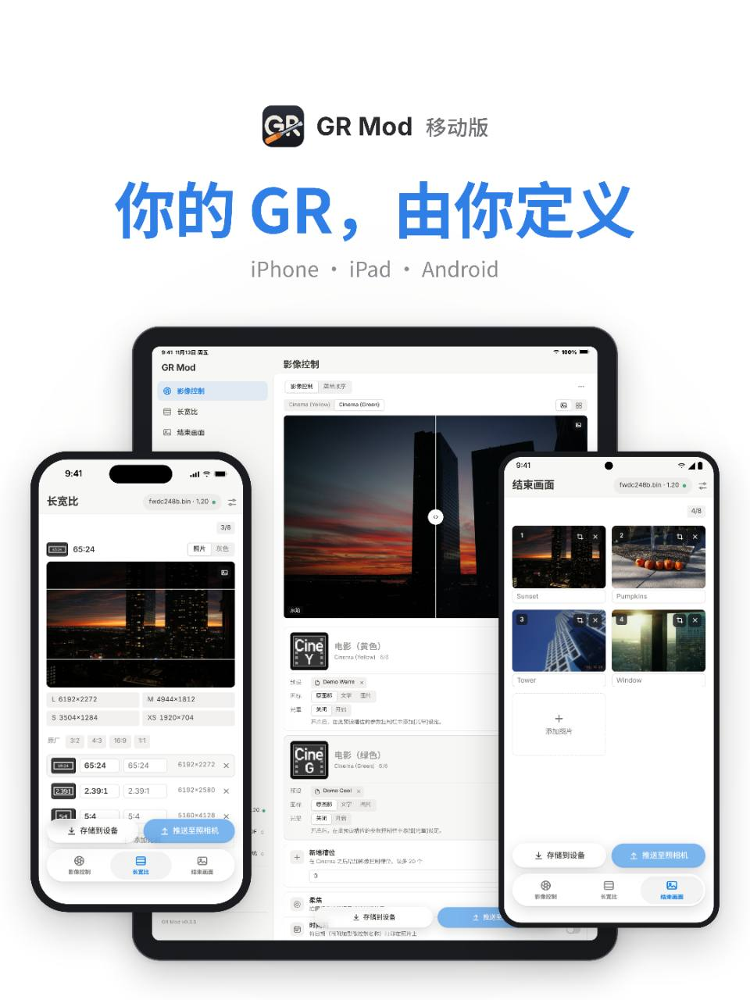

# GR Mod

Customize your Ricoh GR with your own Image Control presets, aspect ratios, and power-off images—plus additional shooting and display options.

**[Download for Windows, macOS, or Android](https://github.com/Maxwooow/Ricoh-GRMod/releases)** · **[Get the iPhone and iPad app](https://apps.apple.com/app/id6834232648)**

> GR Mod is an independent, open-source project. It is not a Ricoh product.

<p align="center">
  
  
</p>

## Download

| Platform | Download |
| --- | --- |
| Windows | [Latest release](https://github.com/Maxwooow/Ricoh-GRMod/releases) |
| macOS | [Latest release](https://github.com/Maxwooow/Ricoh-GRMod/releases) |
| Android | APK from the [latest release](https://github.com/Maxwooow/Ricoh-GRMod/releases) |
| iPhone and iPad | [App Store: GR Mod - For Ricoh GR IV/III](https://apps.apple.com/app/id6834232648) |
| Linux | [Build from source](#build-from-source); no prebuilt package is currently provided |

See [Releases](https://github.com/Maxwooow/Ricoh-GRMod/releases) for the latest version and release notes.

## Features

- **Image Control presets:** add your own looks from `.cube` LUTs or `.xmp` profiles, adjust their parameters, and reorder or hide looks in the camera menu.
- **Aspect ratios:** add custom ratios alongside the camera's factory options.
- **Power-off images:** add your own End Screen pictures and choose between them in the camera.
- **Soft focus and halation:** create softer images and red or white highlight effects.
- **Date imprint:** add a shooting date, date and time, and optionally the Image Control name to JPEGs.
- **Monochrome looks:** use supported GR IV Monochrome looks on colour GR IV models.
- **Direct Flash:** use guide-number-based flash exposure on supported GR IV firmware.
- **HDR gain maps:** create JPEGs with brighter highlights on compatible HDR displays.
- **More ADJ options:** add ADJ lever slots on supported GR IV firmware.
- **Exposure preview and display options:** access additional preview and automatic screen-brightness settings on supported GR IV firmware.

Features vary by camera model and firmware version. The app only offers options supported by the selected firmware.

## Supported cameras and firmware

| Camera | Supported firmware |
| --- | --- |
| GR IV / GR IV HDF | 1.20 or 1.11 |
| GR IV Monochrome | 1.10 (uses the same file as GR IV 1.20) |
| GR III / GR III HDF | 2.20 or 2.10 |
| GR IIIx / GR IIIx HDF | 1.70 or 1.60 |

Use only firmware intended for your camera model and a base version listed above.

## Quick start

### Windows and macOS

1. Download and open GR Mod.
2. Select your camera and a supported firmware version.
3. Open your own official Ricoh firmware file, or let GR Mod download it from Ricoh's website.
4. Choose the features and presets you want, then follow the app's instructions to write the modified firmware to a memory card.
5. Install the firmware on the camera using its normal firmware-update process.

**macOS first launch:** unzip `GRMod-mac.zip` and move `GR Mod.app` to Applications. The app is signed ad hoc rather than with an Apple Developer ID. If macOS blocks it, open **System Settings › Privacy & Security** and select **Open Anyway**. Allow access to removable volumes when macOS asks; otherwise, GR Mod cannot write to the memory card.

### Android, iPhone, and iPad

1. Install the app and select your camera and firmware.
2. Choose your customizations.
3. Save the finished firmware to your device, or send it directly to a supported GR IV over Bluetooth and Wi-Fi.

Wireless transfer requires the firmware's base version to match the version currently installed on the camera. See the [mobile guide](mobile/README.md) for platform requirements and transfer details.

## Restore factory firmware

Before returning to the official firmware, reset the camera to factory defaults. Settings created by GR Mod—such as an added look, aspect ratio, or ADJ function—may not be understood by the official firmware.

You can restore the official firmware from the Image Control page or the firmware copies page. After installing a newer official Ricoh firmware, you may not be able to return to an earlier version.

> **Use modified firmware at your own risk.** Check the model and firmware version carefully, keep the camera sufficiently charged, and do not interrupt a firmware update.

## Documentation

- [Mobile app guide](mobile/README.md)
- [Desktop shell guide](shell/README.md)
- [Automatic screen brightness](docs/bright-auto.md)
- [Technical notes and release archive](docs/technical-notes.md)—implementation details, emulator checks, firmware research, and earlier release notes

GR Mod does not include Ricoh firmware. It reads a firmware file supplied by the user or downloads one from Ricoh's official website under Ricoh's licence terms.

## Build from source

From the repository root:

```sh
npm install
npm -w ui run build
cd shell
```

Then build for your platform:

| Command | Output |
| --- | --- |
| `./build.sh windows` | `dist/GRMod.exe` |
| `./build.sh mac` | `dist/GR Mod.app` and `dist/GRMod-mac.zip` |
| `./build.sh linux` | `dist/grmod` (x64) |

On macOS and Linux, GR Mod opens in a supported Chromium-based browser when available, or in the default browser. On Linux, the memory card must be mounted before it appears in the app; the folder picker requires `kdialog` or `zenity`.

### Run tests

```sh
npm -w core test
cd shell
go test ./...
go test -tags desktop ./...
```

Some byte-identity tests require official firmware files in `core/testdata/private/`. Those files are not distributed with this repository.

See the [mobile guide](mobile/README.md) for Android and iOS build instructions.

## Licence and acknowledgements

GR Mod is free software licensed under [GNU GPL version 2 only](LICENSE) (`GPL-2.0-only`).

- The aspect-ratio compiler is based on [DoYitNow/gr-custom-tool](https://github.com/DoYitNow/gr-custom-tool).
- The Monochrome unlock follows the method of [lemonadesaltbagel/GR4-MonoUnlock](https://github.com/lemonadesaltbagel/GR4-MonoUnlock); no code from that project is included.
- The power-off image method builds on public research from [radium-wang/ricoh-gr4-firmware-analysis-and-feature-expansion](https://github.com/radium-wang/ricoh-gr4-firmware-analysis-and-feature-expansion).

The sample image `ui/src/assets/preview.jpg` and Ricoh firmware are not covered by the project's software licence.
